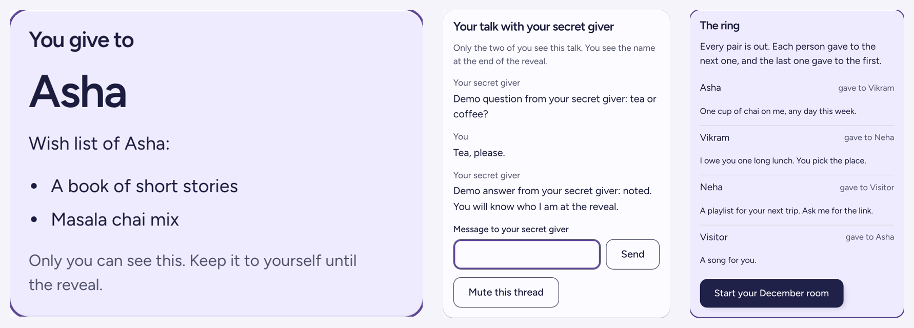

# Solstice

A Secret Santa for your group, on one link. Built on the Nexconn Chat SDK for the Nexconn Build
Challenge 2026.

In a Secret Santa, a giver cannot ask "what size?" without giving away the secret. Solstice puts the
whole exchange in one live room: the group talks, each giver asks their person questions as "Your
secret giver", and every phone shows the reveal live, with cheers.

**Try it:** <https://solstice-black.vercel.app>. Alone? Tap "Try the 3-minute demo": the website plays
three members.

**The secret holds.** Nobody can learn who gives to whom before the reveal, not even the organizer. A
security test calls all 11 room routes as 8 kinds of caller (organizer, member, guest, outsider,
removed member, unknown person, forged cookie, no cookie). A second test reads every answer and every
page before the reveal: none links a giver to a pair.



## What it does

1. The organizer makes a room ("Tonight round" for a party, "December room" for a later date) and
   shares one link. Nobody makes an account.
2. Members join with a name, talk in the room and write wish lists.
3. The organizer draws the names. Each person sees only their own receiver, in the draw panel and as
   a private message in room talk.
4. Mask talk: each giver asks their receiver questions as "Your secret giver". The receiver answers.
   Nobody learns who the giver is.
5. The reveal: the organizer taps, and every phone shows the same pair, live, with cheers. After the last pair the
   masks come off and the room shows the ring.

## How it uses Nexconn

Nexconn carries every live part of the room: the group chat, the private draw card, the alert for a
new secret message, the reveal on every phone, and the cheers. The secret messages stay in our
database. Nexconn only tells the receiver's phone that a new message is waiting, with no text and no
sender, so the chat service never learns who the giver is.

| Product part | Nexconn feature | Code |
| --- | --- | --- |
| Room talk | Group channel, live messages and history | `lib/nexconn-client.ts`, `lib/room-talk.ts` |
| Identity | Access token issue, and expiry when a member is removed | `lib/room-talk.ts` |
| Live screens | Custom message `Solstice:Signal` from the server | `lib/signal.ts` |
| Mask talk signal | Targeted custom message to one member, with no text and no sender | `lib/signal.ts` |
| Draw card in room talk | Targeted custom message `Solstice:DrawCard` to one giver | `lib/signal.ts` |
| Cheers at the reveal | Custom message `Solstice:Cheer` from the browser | `lib/nexconn-client.ts` |
| Kind words | Profanity filter with the website's word list | `lib/word-list.ts` |

The specification is in `SPEC.md`, the task plan in `tasks/`, and the write-up source in `docs/`.

## Run it on your machine

1. Install Node.js 22 or later and PostgreSQL 17.
2. Create a database, for example `createdb solstice_dev`.
3. Copy `.env.example` to `.env.local` and set real values.
4. Run `npm install`, then `npm run db:migrate`, then `npm run dev`.
5. Open http://localhost:3000.

## Settings

The server reads its settings from the environment and refuses to start on a missing value or a
placeholder.

| Name | Needed | What it is |
| --- | --- | --- |
| `DATABASE_URL` | Always | PostgreSQL address. On the host, use the pooled address |
| `SESSION_SECRET` | Always | 32 or more random characters. It signs the identity cookie |
| `NEXCONN_APP_KEY`, `NEXCONN_APP_SECRET`, `NEXCONN_REGION` | In production, unless `CHAT=off` | From the Nexconn console. Region is `sg`, `na` or `sau` |
| `CHAT` | Optional | `off` runs production with chat switched off. Do not set it together with the Nexconn keys |
| `DATABASE_URL_DIRECT` | Only on the machine that runs migrations | The direct (not pooled) address of the hosted database |

## Checks

```
npm test            unit and integration tests (needs a local database named solstice_test)
npm run typecheck   type check
npm run lint        lint
npm run build       production build
npm run test:e2e    browser tests against the production build, with chat switched off
```

Two more commands call the real Nexconn app with the keys from `.env.local`. They use fixed test
user ids, so a run adds no new users:

```
npm run test:smoke      the server calls and the browser SDK
npm run test:e2e:talk   two browsers talk in one room
```

## Deploy

The website runs on a Node.js host with a PostgreSQL 17 database.

1. Set `DATABASE_URL_DIRECT` in `.env.local` and run `npm run db:migrate:live`. The command prints
   the database host before it runs, and applies each migration file one time.
2. Set `DATABASE_URL` (pooled address), `SESSION_SECRET` and the chat settings on the host.
3. Deploy the `main` branch.
4. Run the checks that write nothing against the public address:
   `E2E_BASE_URL=https://your-address npm run test:e2e`

Every response carries a content security policy and the other security headers from
`next.config.ts`. To go back to an earlier version, promote the earlier deployment on the host.
A migration only adds to the schema, so an earlier version of the code runs on a newer schema.
